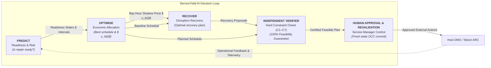

# 00 — Executive Product Overview

**Project:** ServiceYield AI  
**Tagline:** Predict · Optimise · Recover  
**Theme:** AI & Automation (Theme 1, Tek-Qubit 2026)  
**Primary Persona:** Dealership Service Manager  
**Product Positioning:** Proposed decision-support and economic yield optimisation extension to Tekion Automotive Retail Cloud (ARC) and Automotive Partner Cloud (APC)  
**Development Baseline:** Greenfield implementation (incorporating verified architectural concepts from StallBreaker 2)  
**Document Status:** Approved & Authoritative Architecture Reference (Phase 0)

---

## 1. Product Mission & Economic North Star
Modern automotive dealership service operations ("fixed operations") represent the operational and financial backbone of dealership profitability. While vehicle sales account for the majority of gross top-line turnover (~86%), fixed operations generate **48% to 59% of total dealership gross profit** [PUBLIC: Presidio-NCM Q4 2025, NADA 2025]. 

Despite this outsized financial significance, dealership service workshops routinely experience severe operational friction:
- High-value specialist bays sit blocked by stalled vehicles waiting for parts.
- Downstream repair orders are delayed, causing cascading customer promise slips.
- Technicians on flat-rate pay experience unpaid idle time while waiting for parts or bay reallocations.
- Managers make localized, ad-hoc decisions without visibility into the holistic economic consequence across the shop.

### The ServiceYield AI Mission
> **Maximise the feasible economic contribution generated by every available service-bay hour while rigorously protecting customer delivery commitments and respecting physical operational constraints.**

ServiceYield AI transforms dealership fixed operations from reactive, siloed triage into a closed-loop, predictive, economically coherent decision system.

---

## 2. Core Value Proposition: The Three Connected Capabilities
ServiceYield AI does not treat service scheduling, parts procurement, and delay recovery as three disconnected software silos. Instead, it couples them into a single continuous intelligence loop powered by a shared canonical state and an explicit constraint model:

### 2.1 PREDICT — Predictive Service Readiness
- **Core Question:** *Can this repair realistically proceed within its required time window without stalling?*
- **Inputs:** Active Repair Orders (ROs), bills of materials (BOM), supplier parts delivery ETAs, receiving/inspection overheads, technician shift rosters, skill matrices, bay equipment compatibility, operation flat-rate times, and original customer delivery promises.
- **Categorical Output:** Four explicit, non-overlapping readiness states:
  - `READY`: All hard constraints satisfied; vehicle rollable; parts in inventory or confirmed delivered; qualified technician and compatible bay available.
  - `AT_RISK`: Potential delay or uncertainty threatens latest feasible start time ($P(\text{usable\_ready} > \text{latest\_start}) > \tau_{\text{raise}}$).
  - `BLOCKED`: A known hard gate is violated (part backordered, technician absent, bay physically obstructed, vehicle immobilized).
  - `UNKNOWN`: Critical telemetry is missing or stale. Fails closed—never guesses readiness.

### 2.2 OPTIMISE — Economic Service Yield Optimiser
- **Core Question:** *Which combination of jobs, technicians, bays, parts, and discrete time slots produces the highest feasible economic contribution while honouring customer delivery promises?*
- **Mathematical Engine:** Google OR-Tools CP-SAT (Constraint Programming - Satisfiability) formulated over 5-minute integer time ticks ($H = 288$ ticks / 24 hours), backed by a deterministic Priority-Rule Earliest-Fit heuristic (T1) for instantaneous preview and fallback.
- **Objective Balance:** Jointly evaluates gross labour contribution, parts margins, expedite sourcing fees, customer lateness penalties, bay-blocking costs, and schedule churn.
- **Key Output:** Mathematically verified baseline workshop schedule and the **Bay-Hour Shadow Price** ($\nu_b(t)$)—the marginal economic value of service bay capacity across space and time.

### 2.3 RECOVER — ServiceYield Recovery Engine (StallBreaker 2 Greenfield)
- **Core Question:** *When a parts delay, technician absence, or teardown discovery disrupts the shop, what is the best feasible recovery plan across the entire workshop?*
- **Engine Logic:** A two-layer branch-and-bound sourcing search (evaluating local inventory, sister dealerships, hotshot couriers, and aftermarket suppliers) combined with CP-SAT rescheduling.
- **Economic Trade-Off:** Replaces crude "cheapest part" rules. Evaluates whether spending an extra $\$37$ on hotshot courier freight is justified because it delivers a critical part 110 minutes earlier, freeing a $\$120$/hour diagnostic bay and protecting multiple downstream customer promises.

---

## 3. The Core Differentiator: Bay-Hour Shadow Price ($\nu_b(t)$)
Traditional dealership tools treat workshop scheduling and parts procurement as entirely disconnected operations:
1. Schedulers assign jobs based on static duration estimates and standard calendar availability.
2. Parts departments buy from their default primary supplier or search for the lowest unit cost.
3. Service managers scramble on phone calls when a part is delayed, moving vehicles manually with zero cross-shop economic visibility.

**The ServiceYield Innovation:**
ServiceYield introduces the **Bay-Hour Shadow Price** ($\nu_b(t)$), defined as the marginal economic contribution gained by having an additional available hour of bay type $b$ during time window $t$:
$$\nu_b(t) = \frac{\partial \mathcal{Z}^*}{\partial \text{Capacity}_b(t)}$$

This single economic value acts as the real-time connective tissue across all three modules:
- **Predict** uses $\nu_b(t)$ to prioritize which pending parts require urgent verification (a part destined for a high-$\nu$ bay receives priority scrutiny).
- **Optimise** calculates $\nu_b(t)$ directly by evaluating the dual/marginal value of bay capacity across the rolling horizon.
- **Recover** uses $\nu_b(t)$ to monetize avoided bay-blocking time, establishing a mathematically sound threshold for approving expedited freight or alternative sourcing.

---

## 4. System Governance, Safety & Authority
Dealership operations involve physical vehicles, safety-critical mechanical work, flat-rate employee compensation, and contractual customer commitments. ServiceYield enforces strict architectural guardrails:

| Architectural Principle | Operational Guarantee |
| :--- | :--- |
| **Zero Constraint Trade-offs** | Hard operational constraints (C1–C7) can never be violated, relaxed, or traded away for higher economic contribution. |
| **Independent Verification (L4)** | Every proposed schedule must pass an independent sweep-line occupancy oracle before human presentation. Feasibility is never trusted from solver flags alone. |
| **Human Authority (L5)** | ServiceYield never silently dispatches technicians, places parts purchase orders, moves vehicles, or notifies customers. It presents verified options to the **Service Manager** for explicit approval. |
| **Optimistic Concurrency & Fresh-State Revalidation** | Plans are bound to a cryptographic state snapshot hash (`snapshot_hash`). If shop state mutates between generation and approval, the commit aborts safely. |
| **Host Fail-Open Resilience** | ServiceYield is an advisory overlay. If the engine, database, or network experiences downtime, Tekion ARC continues its native dispatch uninterrupted. |
| **LLM-Disabled Parity** | The platform does not rely on LLMs for core logic. All constraint checking, scheduling, pricing, and verification run deterministically. LLMs provide plain-English explanations only. |

---

## 5. Commercial Sizing & Impact Overview
Based on authoritative NADA and industry operational data [PUBLIC, MODEL]:
- **Average US Rooftop Profile:** 16,300 Repair Orders per year; 11 full-time technicians; ~22,000 clocked hours; $9.7M service and parts sales; 64% fixed absorption.
- **Base-Case Annual Economic Value Created:** **$50.3K net value per paying rooftop** (after applying a 20% inter-lever overlap discount and a 75% operational realization factor).
- **Value Drivers:**
  1. *Predict:* Avoided parts delays and idle technician hours (~$21.5k gross).
  2. *Optimise:* Productive slot fill and capacity sequencing (~$27.7k gross).
  3. *Recover:* Eliminated bay-blocking stalls and mitigated customer delivery penalties (~$34.6k gross).
- **Absorption Impact:** Generates ~0.7 points of fixed absorption improvement per dealership. For a large dealer group, each absorption point represents $20M–$40M in annual operating profit [PUBLIC: McKinsey].
- **Proposed Pricing Model:** SaaS subscription tiered at $600/month (Core: Predict + Recover) and $1,100/month (Pro: Predict + Optimise + Recover), yielding a blended price of ~$900/month ($10.8K/year). Dealer payback is achieved in ~1.2 months with a 4.7× return on software spend.

---

## 6. Phase 0 Goal & Demonstration Scope
Phase 0 establishes the complete mathematical, architectural, and governance foundation for ServiceYield AI. The upcoming Phase 1 implementation targets a fully interactive, deterministic **Decision Replay** built around a canonical six-car synthetic workshop scenario:
- **Fixture S-MATH-01:** Proves the hotshot courier trade-off ($37 extra freight vs 110 minutes bay release), reducing weighted customer lateness from **99 to 33 weighted ticks** (a 66.7% reduction) and generating ~$238 in net economic recovery value.
- **Demo Narrative:** Seamlessly steps the Service Manager through:  
  $$\text{Dealership Baseline} \longrightarrow \text{Readiness Risk} \longrightarrow \text{Initial Optimization} \longrightarrow \text{Disruption Injection} \longrightarrow \text{Recover Analysis} \longrightarrow \text{Verification} \longrightarrow \text{Manager Approval}.$$
