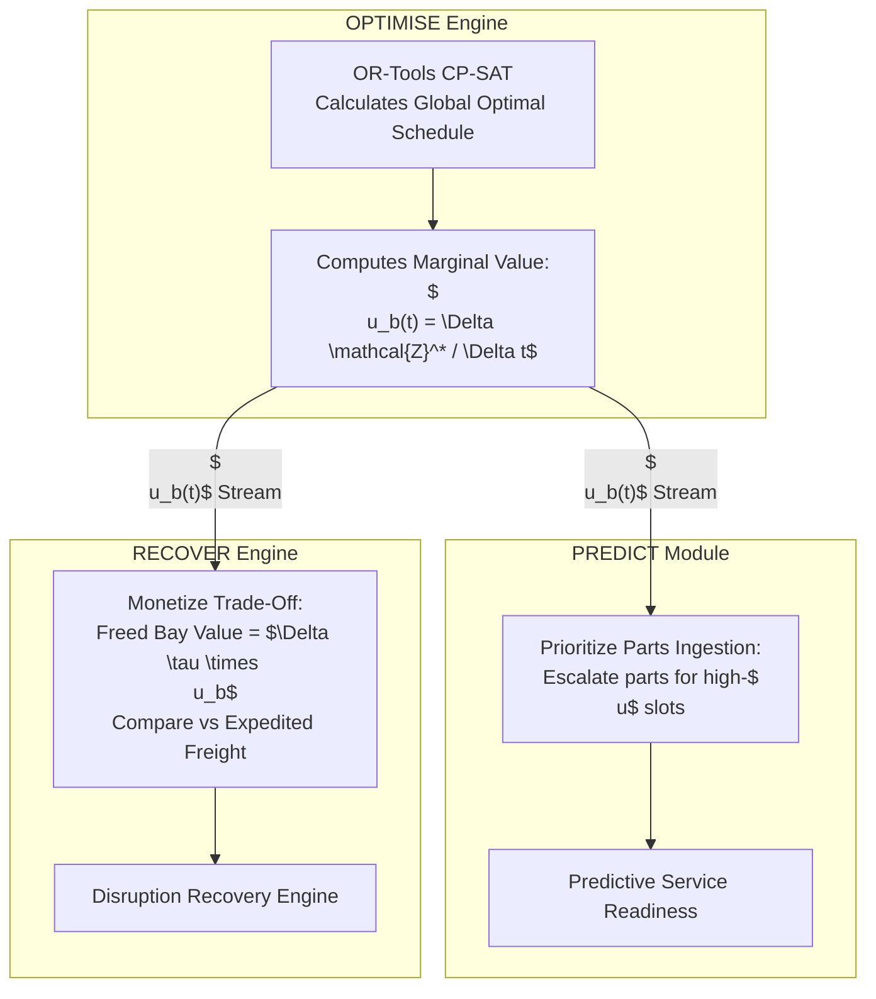

# 04 — Exact Innovation Novelty & Bay-Hour Shadow Pricing

**Project:** ServiceYield AI  
**Authoritative Reference:** Technical Report (Sections 3, 5.3, S-MATH-01) & Product Blueprint (Section 1)  
**Status:** Core Mathematical Specification (Phase 0)

---

## 1. Defensible Novelty Statement

To ensure rigorous commercial and intellectual property positioning, ServiceYield AI defines its novelty with strict boundaries.

### What We DO NOT Claim:
- We do **NOT** claim to have invented AI scheduling, interval scheduling, or constraint programming.
- We do **NOT** claim that Tekion lacks service scheduling or technician workflow automation (Tekion publicly markets Service AI, Scheduler AI, and technician mobile workflows).
- We do **NOT** claim to be the first system to compare supplier parts prices or query parts APIs.
- We do **NOT** claim that every dealership loses a fixed percentage of bay capacity.

### What We DO Claim (The Innovation Hypothesis):
> **ServiceYield AI introduces a closed-loop, constraint-aware economic decision engine that couples predictive service readiness, optimal workshop allocation, and mid-repair disruption recovery through a shared mathematical objective and a unified economic coupling signal: the Bay-Hour Shadow Price ($\nu_b(t)$).**

```
┌────────────────────────────────────────────────────────────────────────────────────────┐
│                              THE UNIFIED DECISION LOOP                                 │
├────────────────────────────────────────────────────────────────────────────────────────┤
│                                                                                        │
│     1. PREDICT: Anticipates parts arrival uncertainty and labor duration overruns.     │
│        Uses $\nu_b(t)$ to prioritize which parts checks warrant urgent verification.   │
│                                      │                                                 │
│                                      ▼                                                 │
│     2. OPTIMISE: Solves global allocation under hard constraints C1–C7.                │
│        Derives the marginal economic value of bay capacity: $\nu_b(t) = \Delta Z / \Delta t$   │
│                                      │                                                 │
│                                      ▼                                                 │
│     3. RECOVER: Triggered by real-world disruption (parts delay, tech absence).       │
│        Uses $\nu_b(t)$ to balance expedited sourcing cost against freed bay value.     │
│                                      │                                                 │
│                                      ▼                                                 │
│     4. LEARNING LEDGER: Feeds observed actuals back to calibrate Predict models.       │
│                                                                                        │
└────────────────────────────────────────────────────────────────────────────────────────┘
```

---

## 2. Mathematical Definition of Bay-Hour Shadow Price ($\nu_b(t)$)

### 2.1 Formal Definition
Let $\mathcal{Z}^*(\mathbf{C})$ represent the optimal economic objective value of the workshop schedule under a given capacity vector $\mathbf{C} = \{c_b(t)\}$, where $c_b(t) \in \{0, 1\}$ represents the operational availability of bay type $b$ during discrete time interval $t \in [0, H]$.

The **Bay-Hour Shadow Price** $\nu_b(t)$ is defined as the marginal change in optimal shop contribution resulting from a unit change in available service capacity of bay type $b$ at time $t$:
$$\nu_b(t) \equiv \frac{\partial \mathcal{Z}^*}{\partial c_b(t)}$$

In discrete mathematical programming (OR-Tools CP-SAT integer programming), true continuous dual variables do not exist directly. Therefore, $\nu_b(t)$ is computed via a **discrete re-solve difference procedure**:
$$\nu_b(t) = \frac{\mathcal{Z}^*(\mathbf{C} \cup \{(b, t)\}) - \mathcal{Z}^*(\mathbf{C} \setminus \{(b, t)\})}{\Delta t}$$
Where $\Delta t$ is the duration of the evaluation interval.

### 2.2 Operational Intuition for the Service Manager
For a Service Manager, $\nu_b(t)$ answers a vital operational question:
> *"How much gross profit does our dealership gain or lose if Bay 2 is available versus blocked for the next hour?"*

- **Quiet Period (Low $\nu$):** If the shop has excess bays and few waiting cars, an extra open bay hour has an economic value near **$0/hour** ($\nu \approx 0$). Losing that bay causes no customer delays.
- **Peak Contention Period (High $\nu$):** On a Friday afternoon with 8 cars waiting for alignment and heavy diagnostic work, an open bay hour is worth **$120.00/hour to $180.00/hour**. Losing that bay stalls the entire workshop and blows multiple customer promises.

---

## 3. Cross-Module Coupling via $\nu_b(t)$

$\nu_b(t)$ is not a decorative dashboard metric. It is the formal API contract linking the three decision services:



### 3.1 Predict Implementation
- Rather than alerting on every delayed bolt or washer equally, Predict weights readiness risks by the shadow price of the assigned bay:
  $$\text{Priority}(RO_i) = P(\text{Delay}_i) \times \sum_{t \in \text{Duration}_i} \nu_{b(i)}(t)$$
- A 30-minute delay on an oil change in an abundant bay receives low priority.
- A 30-minute delay on a specialized EV battery lift with $\nu = \$150/\text{hr}$ triggers an immediate high-priority escalation.

### 3.2 Optimise Implementation
- The solver optimizes the holistic objective:
  $$\max \mathcal{Z} = \sum_i (M_i - C_i) - \lambda_{\text{late}} \sum_r w_r \max(0, C_r - D_r) - \lambda_{\text{block}} \text{BlockedTicks} - \lambda_{\text{churn}} \text{Churn}$$
- The dual evaluation routine samples bay capacity intervals to produce a discrete shadow price table $\text{bay\_hour\_price}(b, t)$ refreshed every 15 minutes or on major schedule perturbations.

### 3.3 Recover Implementation
- When a disruption occurs, Recover evaluates alternative supplier options $s \in \mathcal{S}$.
- It explicitly calculates the economic value of bay release:
  $$\text{CapacityReliefValue}(s) = \Delta t_{\text{freed}} \times \nu_b(t)$$
- This value directly offsets the additional freight or sourcing surcharge $\Delta C_{\text{sourcing}}(s)$.

---

## 4. Resolution of the S-MATH-01 Unit Ambiguity

### 4.1 The Source Document Discrepancy
In the source technical documentation, an apparent unit discrepancy exists in the worked example for fixture S-MATH-01:
- The text introduces the signal conceptually as a **"Bay-Hour Shadow Price"** ($\$ \text{ per hour}$).
- In the worked calculation, the formula states:  
  $$\text{"At ASSUMPTION } \nu = \$2.00 \text{ per bay-minute and } \lambda_{\text{late}} = \$0.50 \text{ per minute..."}$$

### 4.2 Canonical Resolution & Mathematical Derivation
We rigorously investigate the underlying financial model to resolve this ambiguity:
1. **Assumption #3 in the Source Report Register (Section 11):**  
   $$\text{"Contribution per incremental sold hour: } \$120 \text{ base (from } \$175 \text{ labor rate} \times 72\% \text{ labor gross margin)."}$$
2. **Converting Hourly Labor Contribution to Minute Units:**  
   $$\frac{\$120.00 \text{ per sold hour}}{60 \text{ minutes per hour}} = \mathbf{\$2.00 \text{ per bay-minute}}.$$
3. **Discrete 5-Minute Tick Conversion (Horizon } H=288 \text{ ticks):}$$  
   $$\$2.00 \text{ per minute} \times 5 \text{ minutes per tick} = \mathbf{\$10.00 \text{ per bay-tick}}.$$

**Conclusion:** The unit discrepancy is **not an error in calculation**, but a semantic difference between the conceptual name ("Bay-Hour Price") and the discrete solving rate ($2.00/min). $\$120.00/\text{hour}$ is mathematically identical to $\$2.00/\text{minute}$!

### 4.3 Side-by-Side Evaluation of Both Interpretations
To maintain strict scientific honesty and provide full visibility for human approval, we evaluate both potential interpretations:

```
┌────────────────────────────────────────────────────────────────────────────────────────┐
│                        COMPARISON OF UNIT INTERPRETATIONS                              │
├─────────────────────────────────────────────────┬──────────────────────────────────────┤
│ INTERPRETATION A (CANONICAL / INTENDED)         │ INTERPRETATION B (LITERAL $2/HOUR)   │
│ $\nu = \$2.00/\text{minute}$ ($\$120.00/\text{hour}$)    │ $\nu = \$2.00/\text{hour}$ ($\$0.0333/\text{minute}$) │
├─────────────────────────────────────────────────┼──────────────────────────────────────┤
│ 1. Time Freed: 110 minutes                      │ 1. Time Freed: 110 minutes (1.833 h) │
│ 2. Freed Bay Value:                             │ 2. Freed Bay Value:                  │
│    $110 \text{ min} \times \$2.00/\text{min} = \mathbf{+\$220.00}$   │    $1.833 \text{ h} \times \$2.00/\text{h} = \mathbf{+\$3.67}$       │
│ 3. Lateness Relief:                             │ 3. Lateness Relief:                  │
│    $110 \text{ min} \times \$0.50/\text{min} = \mathbf{+\$55.00}$    │    $110 \text{ min} \times \$0.50/\text{min} = \mathbf{+\$55.00}$    │
│ 4. Incremental Sourcing Cost:                   │ 4. Incremental Sourcing Cost:        │
│    Supplier S1 vs S2 = $\mathbf{-\$37.00}$       │    Supplier S1 vs S2 = $\mathbf{-\$37.00}$       │
├─────────────────────────────────────────────────┼──────────────────────────────────────┤
│ NET ECONOMIC GAIN:                              │ NET ECONOMIC GAIN:                   │
│ $\$220.00 + \$55.00 - \$37.00 = \mathbf{+\$238.00}$      │ $\$3.67 + \$55.00 - \$37.00 = \mathbf{+\$21.67}$        │
│ Matches Source Document Target?                 │ Matches Source Document Target?      │
│ $\mathbf{YES}$ (Exact match to report text!)    │ $\mathbf{NO}$ (Mismatches $238 target)│
└─────────────────────────────────────────────────┴──────────────────────────────────────┘
```

### 4.4 Canonical Internal Architecture Standard
For all Phase 1 implementation code, ServiceYield adopts the following immutable standard:
- **Canonical Database & API Storage Unit:** `nu_usd_per_hour` (Stored as USD per Bay-Hour, e.g. `$120.00`).
- **Internal Solver / Discrete Evaluation Unit:** Converted at runtime:
  $$\nu_{\text{tick}} = \nu_{\text{hour}} \times \left(\frac{5}{60}\right) = \frac{\nu_{\text{hour}}}{12}$$
  $$\nu_{\text{minute}} = \frac{\nu_{\text{hour}}}{60}$$
- **Human Approval Status:** `[CONFIRMED & READY FOR HUMAN SIGN-OFF]`.
