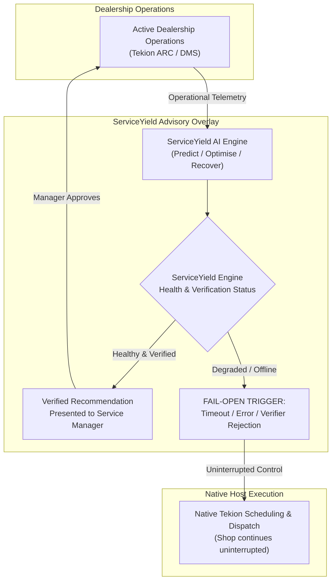

# 06 — System Architecture & Layered Responsibilities

**Project:** ServiceYield AI  
**Authoritative Reference:** Technical Report (Sections 5.1, 5.6, 7, 8) & Product Blueprint (Sections 7, 8)  
**Status:** Greenfield Architectural Blueprint (Phase 0)

---

## 1. Architectural Philosophy: The Seven-Layer Separation

ServiceYield AI is architected as an advisory decision-intelligence overlay. The system enforces strict layer boundaries where **pure mathematical optimization is completely separated from state persistence, verification, and human authority**.

```
┌────────────────────────────────────────────────────────────────────────────────────────┐
│                              L0: ADAPTER & INGESTION LAYER                             │
│       Synthetic Dealership Adapter | Future Tekion APC Webhooks & Event Polling        │
└───────────────────────────────────────────┬────────────────────────────────────────────┘
                                            │
                                            ▼
┌────────────────────────────────────────────────────────────────────────────────────────┐
│                              L1: CANONICAL STATE & EVENT LOG                           │
│     Append-Only Event Store | Snapshot Generator | Read-Set Hasher (SHA-256)           │
└───────────────────────────────────────────┬────────────────────────────────────────────┘
                                            │
                                            ▼
┌────────────────────────────────────────────────────────────────────────────────────────┐
│                              L2: ELIGIBILITY & PHYSICAL GATES                          │
│     Fitment Graph | Supersession | ATP Ledger | Vehicle Physical State Machine         │
└───────┬───────────────────────────────────┼────────────────────────────────────┬───────┘
        │                                   │                                    │
        ▼                                   ▼                                    ▼
┌───────────────────────┐   ┌───────────────────────┐    ┌───────────────────────┐
│  L3.1: PREDICT ENGINE │   │ L3.2: OPTIMISE ENGINE │    │  L3.3: RECOVER ENGINE │
│   Empirical Quantiles │   │   OR-Tools CP-SAT     │    │   Two-Layer B&B       │
│   4 Readiness States  │   │   $\nu_b(t)$ Derivation│   │   Pareto Rescheduler  │
└───────┬───────────────┘   └───────┬───────────────┘    └───────┬───────────────┘
        │                           │                            │
        └───────────────────────────┼────────────────────────────┘
                                    │
                                    ▼
┌────────────────────────────────────────────────────────────────────────────────────────┐
│                              L4: INDEPENDENT VERIFIER                                  │
│   Sweep-Line Occupancy Oracle | Validates C1–C7 | Sole Authority on Feasibility        │
└───────────────────────────────────────────┬────────────────────────────────────────────┘
                                            │
                                            ▼
┌────────────────────────────────────────────────────────────────────────────────────────┐
│                              L5: AUTHORITY & COMMIT GATEWAY                            │
│     Manager Approval UI | OCC Fresh-State Revalidation | Transactional Outbox          │
└───────────────────────────────────────────┬────────────────────────────────────────────┘
                                            │
                                            ▼
┌────────────────────────────────────────────────────────────────────────────────────────┐
│                              L6: CONTINUOUS LEARNING LEDGER                            │
│     Predicted vs Actual Telemetry | Shadow Price Cache Refresh | Conformal Tracking     │
└────────────────────────────────────────────────────────────────────────────────────────┘
```

---

## 2. Layer Responsibilities & Technical Stack

### L0 — Adapters & Ingestion
- **Responsibility:** Ingests external events (RO opened, part status change, technician clock-in/out, bay inspection, customer promise update) with strict payload validation.
- **Technology:** FastAPI, Pydantic v2 schemas, cryptographic webhook signature verification, idempotency key tracking.
- **Guarantee:** Never mutates internal state directly; translates external JSON into strongly-typed domain events.

### L1 — Canonical State & Snapshot Store
- **Responsibility:** Maintains the authoritative shop state per rooftop. Provides immutable, point-in-time state snapshots (`snapshot_hash`) for solvers.
- **Technology:** PostgreSQL 16, SQLAlchemy 2.0 (async/typed), Alembic migrations.
- **Guarantee:** Pure functions above L5 operate solely on snapshot hashes. Any solver or predictor receives a read-only immutable snapshot.

### L2 — Eligibility & Physical State Gates
- **Responsibility:** Fails invalid candidates before solving starts. Evaluates ACES/PIES part fitment, approved supersession chains, Available-to-Promise (ATP) expiration, technician skill matrix match, and vehicle physical state.
- **Vehicle State Machine:**
  - `IMMOBILIZED_ON_LIFT`: Disassembled on lift; cannot be moved; requires bay occupancy until completed or made rollable.
  - `ROLLABLE`: Vehicle assembled; can be staged to holding or moved to another lift if porter available.
  - `IN_HOLDING`: Staged in parking lot or staging stall.
  - `MOVE_PENDING`: In transit between holding and bay. Does not free bay until physical arrival confirmed.
  - `UNKNOWN`: Telemetry missing. Fails closed: **no vehicle movement permitted**.

### L3 — Decision Services (Predict, Optimise, Recover)
- **Responsibility:** Stateless solver pool computing readiness, optimal schedules, and disruption recovery options.
- **Technology:** Python 3.12, Google OR-Tools CP-SAT, NumPy, Pandas.
- **Guarantee:** Solvers are 100% stateless and horizontally scalable. No solver can write directly to the database or trigger external API calls.

### L4 — Independent Verifier
- **Responsibility:** Independent re-verification of all proposed plans against hard constraints C1–C7.
- **Technology:** Pure Python sweep-line interval occupancy oracle. Shares zero constraint-building code with L3 CP-SAT.
- **Guarantee:** The L4 Verifier is the sole code authorized to mark a plan as `VERIFIED_FEASIBLE`.

### L5 — Authority & Commit Gateway
- **Responsibility:** Manages human interaction, approval workflows, optimistic concurrency revalidation, and transactional outbox.
- **Technology:** Single-writer leader lease per rooftop, optimistic concurrency control (OCC) on snapshot read-sets, transactional outbox pattern.
- **Guarantee:** No external action (supplier order, technician dispatch, customer notification) occurs without explicit Service Manager approval and successful read-set version verification.

### L6 — Learning & Calibration Ledger
- **Responsibility:** Records predicted-versus-actual telemetry (actual parts arrival vs ETA, actual flat-rate hours vs flagged hours, realized contribution).
- **Technology:** PostgreSQL outcome ledger, quantile calibration monitors, shadow price cache.

---

## 3. Host Fail-Open Architecture

A core architectural tenet is that **ServiceYield AI is an advisory co-pilot, never a single point of failure for the dealership**.



### Fail-Open Operational Rules:
1. **Solver Timeout / Failure:** If CP-SAT times out without an incumbent, the system serves the verified T1 priority schedule tagged as `"Fast plan, not optimised"`. If T1 fails, it displays `"Manual dispatch required"` and host continues.
2. **Platform Outage:** If the ServiceYield backend is completely unreachable, the Tekion ARC UI displays an advisory banner (`"ServiceYield offline — using native scheduling"`), and the native Tekion dispatcher continues normal operations.
3. **Stale State Abort:** If dealership state mutates while the manager is reviewing a proposal, the commit transaction aborts safely, displaying `"Shop state updated — re-evaluating plan"`. No invalid writeback occurs.
