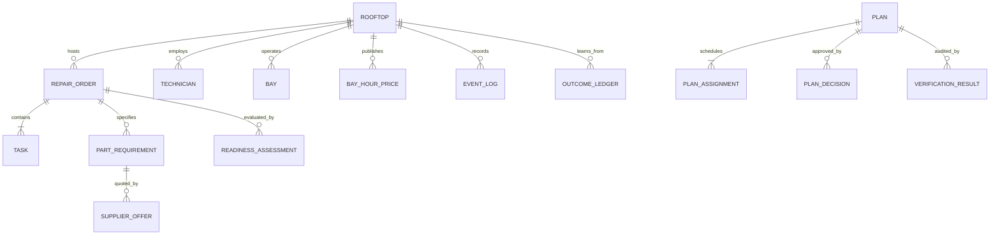

# 07 — Canonical State & Domain Model

**Project:** ServiceYield AI  
**Authoritative Reference:** Technical Report (Sections 5.1, 5.5) & Product Blueprint (Sections 8, 9)  
**Status:** Canonical Database & Entity Specification (Phase 0)

---

## 1. Domain Entity Relationship Diagram

The canonical state model unifies all workshop entities into a strongly-typed, relational schema. Every mutable entity carries a version counter (`version`), enabling optimistic concurrency control and cryptographic snapshot generation:



---

## 2. Core Domain Entities & Attributes

### 2.1 RepairOrder (`repair_order`)
Represents an active customer or internal repair contract.
- `ro_id` (TEXT, PK): Unique RO identifier (e.g., `RO-104`).
- `rooftop_id` (TEXT, FK): Dealership identifier.
- `vehicle_id` (TEXT): VIN or internal vehicle asset tag.
- `customer_id` (TEXT): Customer account identifier.
- `promised_at` (TIMESTAMPTZ): Immutable customer delivery promise time $D_r$.
- `priority` (INT): Customer/service priority weight $w_r$ (default: 1).
- `status` (TEXT): `OPEN`, `IN_PROGRESS`, `STALLED`, `COMPLETED`, `CLOSED`.
- `physical_state` (TEXT): `IMMOBILIZED_ON_LIFT`, `ROLLABLE`, `IN_HOLDING`, `MOVE_PENDING`, `UNKNOWN`.
- `assigned_bay_id` (TEXT, Nullable, FK): Physical bay currently occupied by vehicle.
- `version` (INT): Monotonically increasing entity mutation counter.
- `updated_at` (TIMESTAMPTZ): Last modified timestamp.

### 2.2 Task (`task`)
An individual repair or diagnostic operation within an RO (e.g. "Transmission Teardown").
- `task_id` (TEXT, PK): Unique task identifier (e.g., `TASK-104-01`).
- `ro_id` (TEXT, FK): Associated Repair Order.
- `sequence_order` (INT): Topological DAG sequence index.
- `required_skill` (TEXT): Required technician skill certification code (e.g., `TRANSMISSION_SPECIALIST`).
- `required_bay_type` (TEXT): Required bay capability (e.g., `HEAVY_DIAGNOSTIC_LIFT`).
- `flat_rate_minutes` (INT): Book/flat-rate operation duration.
- `estimated_duration_ticks` (INT): Expected duration in discrete 5-minute ticks ($d_o$).
- `status` (TEXT): `PENDING`, `IN_PROGRESS`, `COMPLETED`.
- `version` (INT): Entity mutation counter.

### 2.3 Technician (`technician`)
A service technician available for work dispatch.
- `tech_id` (TEXT, PK): Unique technician identifier (e.g., `TECH-02`).
- `rooftop_id` (TEXT, FK): Dealership identifier.
- `name` (TEXT): Technician full name.
- `skill_certifications` (TEXT[]): List of verified skills (e.g., `['EV_CERTIFIED', 'TRANSMISSION']`).
- `shift_start_tick` (INT): Shift start in discrete ticks (e.g., 96 = 8:00 AM).
- `shift_end_tick` (INT): Shift end in discrete ticks (e.g., 204 = 5:00 PM).
- `lunch_start_tick` (INT): Mandatory meal break start (e.g., 144 = 12:00 PM).
- `lunch_duration_ticks` (INT): Mandatory meal break length (default: 12 ticks = 60 min).
- `is_active` (BOOL): Active shift status.
- `version` (INT): Entity mutation counter.

### 2.4 Bay (`bay`)
A physical service stall or equipment lift in the workshop.
- `bay_id` (TEXT, PK): Unique bay identifier (e.g., `BAY-01`).
- `rooftop_id` (TEXT, FK): Dealership identifier.
- `name` (TEXT): Display name (e.g., "Heavy Alignment Rack 1").
- `bay_type` (TEXT): Capability code (`HEAVY_LIFT`, `ALIGNMENT`, `EV_ISOLATION`, `STANDARD_2POST`).
- `lifting_capacity_lbs` (INT): Physical weight rating (e.g., 12000).
- `is_operational` (BOOL): Equipment operational status.
- `version` (INT): Entity mutation counter.

### 2.5 PartRequirement (`part_requirement`)
A bill-of-materials component required to complete a task.
- `part_req_id` (TEXT, PK): Unique requirement ID.
- `ro_id` (TEXT, FK): Associated Repair Order.
- `task_id` (TEXT, FK): Specific task requiring the component.
- `oem_part_number` (TEXT): Manufacturer part number.
- `quantity` (INT): Units required.
- `is_in_stock` (BOOL): Local parts inventory availability.
- `usable_ready_tick` (INT, Nullable): Arrival + inspection completed tick.
- `status` (TEXT): `IN_STOCK`, `IN_TRANSIT`, `BACKORDERED`, `UNKNOWN`.
- `version` (INT): Entity mutation counter.

### 2.6 SupplierOffer (`supplier_offer`)
A candidate sourcing offer for a required part.
- `offer_id` (TEXT, PK): Unique quote ID.
- `part_req_id` (TEXT, FK): Associated part requirement.
- `supplier_id` (TEXT): Supplier code (`OEM_PRIMARY`, `SISTER_STORE`, `HOTSHOT_DISTRIBUTOR`).
- `supplier_name` (TEXT): Vendor display name.
- `unit_cost_usd` (NUMERIC(10,2)): Base unit wholesale cost.
- `freight_surcharge_usd` (NUMERIC(10,2)): Expedited shipping/hotshot courier surcharge.
- `quoted_eta` (TIMESTAMPTZ): Quoted arrival timestamp.
- `receiving_inspection_minutes` (INT): Mandatory dealership intake inspection time.
- `usable_ready_tick` (INT): Discrete tick when part is verified mechanically usable.
- `quote_valid_until` (TIMESTAMPTZ): Available-to-promise expiration timestamp.

---

## 3. Plan & Decision Persistence Tables

### 3.1 Plan (`yield_plan`)
```sql
CREATE TABLE yield_plan (
    plan_id TEXT PRIMARY KEY,
    rooftop_id TEXT NOT NULL,
    snapshot_hash TEXT NOT NULL,
    mode TEXT NOT NULL CHECK (mode IN ('PLANNING', 'RECOVERY')),
    objective_usd NUMERIC(12,2) NOT NULL,
    contribution_usd NUMERIC(12,2) NOT NULL,
    lateness_weighted_ticks INT NOT NULL,
    bay_blocked_ticks INT NOT NULL,
    churn_score INT NOT NULL,
    solver_tier TEXT NOT NULL CHECK (solver_tier IN ('T1_HEURISTIC', 'T2_CPSAT', 'T3_LNS')),
    solver_status TEXT NOT NULL CHECK (solver_status IN ('OPTIMAL', 'FEASIBLE', 'INFEASIBLE', 'UNKNOWN')),
    optimality_gap NUMERIC(6,4),
    verifier_passed BOOLEAN NOT NULL DEFAULT FALSE,
    is_committed BOOLEAN NOT NULL DEFAULT FALSE,
    created_at TIMESTAMPTZ NOT NULL DEFAULT NOW()
);
```

### 3.2 PlanAssignment (`plan_assignment`)
```sql
CREATE TABLE plan_assignment (
    assignment_id TEXT PRIMARY KEY,
    plan_id TEXT NOT NULL REFERENCES yield_plan(plan_id) ON DELETE CASCADE,
    task_id TEXT NOT NULL,
    ro_id TEXT NOT NULL,
    tech_id TEXT NOT NULL,
    bay_id TEXT NOT NULL,
    start_tick INT NOT NULL,
    end_tick INT NOT NULL,
    selected_offer_id TEXT,
    created_at TIMESTAMPTZ NOT NULL DEFAULT NOW()
);
```

### 3.3 ReadinessAssessment (`readiness_assessment`)
```sql
CREATE TABLE readiness_assessment (
    ro_id TEXT NOT NULL,
    snapshot_hash TEXT NOT NULL,
    rooftop_id TEXT NOT NULL,
    state TEXT NOT NULL CHECK (state IN ('READY', 'AT_RISK', 'BLOCKED', 'UNKNOWN')),
    p_delay NUMERIC(5,4),
    ready_low_tick INT,
    ready_mid_tick INT,
    ready_high_tick INT,
    calibration TEXT NOT NULL CHECK (calibration IN ('UNCALIBRATED', 'CALIBRATED_LIGHT', 'CALIBRATED', 'DEGRADED')),
    reasons TEXT[] NOT NULL DEFAULT '{}',
    model_version TEXT NOT NULL,
    computed_at TIMESTAMPTZ NOT NULL DEFAULT NOW(),
    PRIMARY KEY (ro_id, snapshot_hash)
);
```

### 3.4 BayHourPrice (`bay_hour_price`)
```sql
CREATE TABLE bay_hour_price (
    rooftop_id TEXT NOT NULL,
    bay_type TEXT NOT NULL,
    hour_of_week SMALLINT NOT NULL CHECK (hour_of_week BETWEEN 0 AND 167),
    nu_usd_per_hour NUMERIC(10,2) NOT NULL,
    snapshot_hash TEXT NOT NULL,
    computed_at TIMESTAMPTZ NOT NULL DEFAULT NOW(),
    PRIMARY KEY (rooftop_id, bay_type, hour_of_week)
);
```

### 3.5 OutcomeLedger (`outcome_ledger`)
```sql
CREATE TABLE outcome_ledger (
    ledger_id TEXT PRIMARY KEY,
    rooftop_id TEXT NOT NULL,
    ro_id TEXT NOT NULL,
    plan_id TEXT REFERENCES yield_plan(plan_id),
    predicted_payload JSONB NOT NULL,
    actual_payload JSONB NOT NULL,
    actual_contribution_usd NUMERIC(12,2),
    actual_lateness_minutes INT,
    recorded_at TIMESTAMPTZ NOT NULL DEFAULT NOW()
);
```

---

## 4. Cryptographic Snapshot Generation (`snapshot_hash`)

To guarantee data consistency and enforce Optimistic Concurrency Control (OCC), every decision service operates strictly against an immutable snapshot hash.

### Hashing Algorithm:
The system computes a deterministic SHA-256 hash over the sorted entity version vector for the rooftop:
$$\mathbf{V} = \left[ (\text{EntityID}_1, \text{Version}_1), (\text{EntityID}_2, \text{Version}_2), \dots, (\text{EntityID}_N, \text{Version}_N) \right]$$
$$\text{snapshot\_hash} = \text{SHA-256}(\text{JSON.stringify}(\text{Sort}(\mathbf{V})))$$

### OCC Revalidation at Approval:
When the Service Manager clicks **[APPROVE & COMMIT]**:
1. L5 retrieves the current live entity versions from PostgreSQL.
2. Re-computes $\text{current\_hash}$.
3. Compares:
   $$\text{IF } \text{current\_hash} == \text{plan.snapshot\_hash} \implies \text{COMMIT TRANSACTION}$$
   $$\text{ELSE } \implies \mathbf{ABORT\ COMMIT\ (HTTP\ 409\ CONFLICT)}$$
4. If aborted, the UI prompts: *"Dealership state has updated since this plan was computed. Re-evaluating optimal recovery."*
