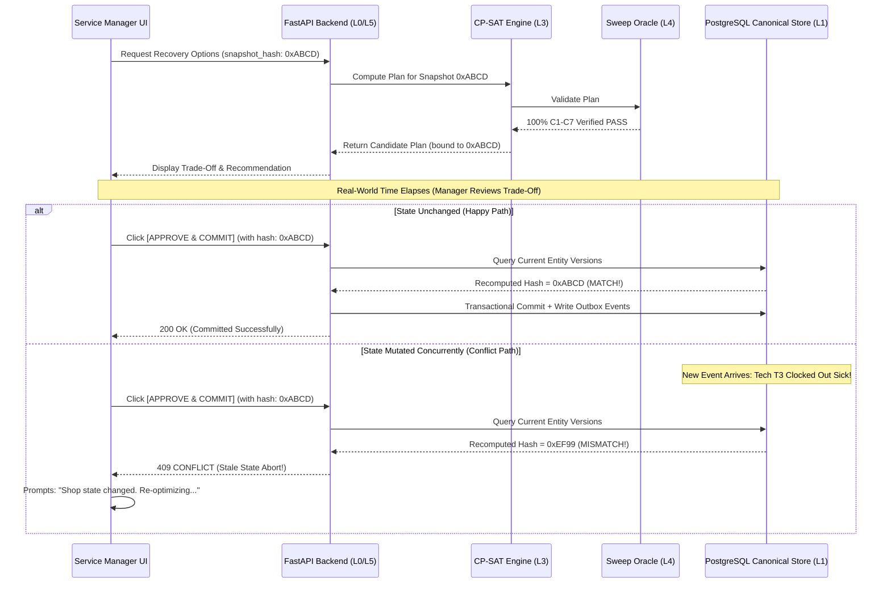

# 12 — Independent Verification & Fresh-State Revalidation

**Project:** ServiceYield AI  
**Authoritative Reference:** Technical Report (Sections 5.1, 5.2, 8.5) & Product Blueprint (Sections 7, 9)  
**Standard:** Independent Feasibility Certification & Optimistic Concurrency Control (Phase 0)

---

## 1. The Necessity of Independent Verification (L4)

In complex constraint-programming and mathematical optimization systems, **the solver's internal claim of "FEASIBLE" or "OPTIMAL" cannot be trusted as an operational safety guarantee**:
- The mathematical model builder might omit a boundary check.
- A relaxation variable might be erroneously left unpenalized.
- An integer conversion overflow could silently drop an overlap constraint.
- Upstream data mapping bugs can produce syntactically valid solver models that are physically impossible in a real service bay.

To provide absolute execution safety, ServiceYield AI implements the **L4 Independent Verifier**:

```
┌────────────────────────────────────────────────────────────────────────────────────────┐
│                        INDEPENDENT VERIFICATION ARCHITECTURE                           │
├────────────────────────────────────────────────────────────────────────────────────────┤
│                                                                                        │
│   ┌────────────────────────────────┐            ┌────────────────────────────────┐     │
│   │   OR-Tools CP-SAT Solver (L3)  │            │   Independent Verifier (L4)    │     │
│   │   • Mixed-Integer Formulation  │            │   • Sweep-Line Occupancy Oracle│     │
│   │   • Optimization Objective     │            │   • Written in Pure Python     │     │
│   │   • Heuristic Branching        │            │   • Shares ZERO Constraint Code│     │
│   └───────────────┬────────────────┘            └────────────────▲───────────────┘     │
│                   │                                              │                     │
│                   ▼                                              │                     │
│   ┌────────────────────────────────┐                             │                     │
│   │      Candidate Plan Output     │─────────────────────────────┘                     │
│   │  (ro_id, tech_id, bay_id,      │   Audits: C1 (Eligibility), C2 (Parts),           │
│   │   start_tick, end_tick, parts) │           C3 (Precedence), C4 (Exclusivity),      │
│   └────────────────────────────────┘           C5 (Movement), C6 (Breaks/Fairness),    │
│                                                C7 (Customer Approvals)                 │
│                                                                                        │
│   ★ RULE: Only the L4 Verifier is authorized to mark a plan as "VERIFIED_FEASIBLE".    │
└────────────────────────────────────────────────────────────────────────────────────────┘
```

---

## 2. Sweep-Line Occupancy Oracle Algorithm

The L4 Verifier operates as an independent $O(N \log N)$ sweep-line interval validation oracle.

### Algorithmic Execution Steps:
1. **Event Decomposition:** Decomposes every task assignment into two discrete point events: `(tick, EVENT_TYPE, entity_id, task_id)`:
   - `START_EVENT` at $\tau = \text{start\_tick}$
   - `END_EVENT` at $\tau = \text{end\_tick}$
2. **Chronological Sweep:** Sorts all events chronologically (with `END_EVENT` ordered before `START_EVENT` at identical ticks to allow seamless contiguous handoffs).
3. **Active Set Sweep:** Advances a virtual sweep-line across the time horizon $\tau \in [0, 288]$:
   - **Bay Capacity Sweep:** Maintains active occupancy set $\mathcal{A}_{\text{bay}}(b)$. On `START`, if $|\mathcal{A}_{\text{bay}}(b)| > 0 \implies \mathbf{REJECT\ (Bay\ Double\ Booking)}$.
   - **Technician Capacity Sweep:** Maintains active task set $\mathcal{A}_{\text{tech}}(k)$. On `START`, if $|\mathcal{A}_{\text{tech}}(k)| > 0 \implies \mathbf{REJECT\ (Technician\ Overlap)}$.
   - **Mandatory Break Sweep:** Asserts that for all $\tau \in [\text{start}, \text{end})$, $\tau \notin [\text{LunchStart}(k), \text{LunchEnd}(k))$. If violated $\implies \mathbf{REJECT\ (Lunch\ Break\ Violation)}$.
4. **Relational Invariant Verification:**
   - **Precedence DAG Audit:** For every $(o1, o2) \in \text{Precedences}$, verifies $\text{start}(o2) \ge \text{end}(o1)$.
   - **Parts Availability Audit:** Verifies $\text{start}(o) \ge \text{usable\_ready}(p)$ for all required parts.
   - **Physical Lift State Audit:** Asserts that an `IMMOBILIZED_ON_LIFT` vehicle is not reassigned to another bay or parked in holding.

---

## 3. Mutation Testing: Proving the Verifier Rejects Model Bugs

To prove that the L4 Verifier is not an ornamental pass-through, the test suite includes automated **mutation test fixtures** that deliberately inject constraint violations into candidate plans:

| Mutation Injector Code | Deliberate Corruption Injected | Expected Verifier Action | Acceptance Standard |
| :--- | :--- | :--- | :--- |
| `MUT-01: BAY_OVERLAP` | Advances Task 2 start tick by 1 tick into Task 1. | **REJECT** (`C4_BAY_DOUBLE_BOOKED`) | 100% Caught |
| `MUT-02: TECH_OVERLAP` | Assigns Tech 1 to two simultaneous tasks. | **REJECT** (`C4_TECH_DOUBLE_BOOKED`)| 100% Caught |
| `MUT-03: LUNCH_BREACH` | Extends morning task 5 minutes into lunch window. | **REJECT** (`C6_BREAK_WINDOW_BREACH`)| 100% Caught |
| `MUT-04: PRECEDENCE_FLIP`| Starts Reassembly before Teardown completes. | **REJECT** (`C3_PRECEDENCE_VIOLATION`)| 100% Caught |
| `MUT-05: EARLY_PART` | Starts repair 5 minutes before part usable-ready tick.| **REJECT** (`C2_PART_NOT_READY`) | 100% Caught |
| `MUT-06: INVALID_MOVE` | Schedules bay release for immobilized vehicle. | **REJECT** (`C5_ILLEGAL_VEHICLE_MOVE`)| 100% Caught |
| `MUT-07: SKILL_MISMATCH` | Assigns EV battery disconnect to Express lube tech. | **REJECT** (`C1_SKILL_INELIGIBLE`) | 100% Caught |

**Acceptance Standard:** The L4 Verifier must achieve a **100.0% kill rate** against all injected mutation faults before Phase 1 completion.

---

## 4. Fresh-State Revalidation & Optimistic Concurrency Control (OCC)

Dealership workshops are dynamic environments. Between the second a recovery plan is computed and the moment the Service Manager clicks **[APPROVE]**, real-world state may change (e.g., another technician calls in sick, or a customer cancels an appointment).

ServiceYield prevents committing stale, obsolete plans via **Optimistic Concurrency Control**:



---

## 5. Transactional Outbox Pattern for Safe External Side-Effects

To guarantee transactional consistency and prevent "ghost orders" in external supplier systems:
1. When a plan is approved and committed, all external side-effects (e.g. `PLACE_SUPPLIER_PURCHASE_ORDER`, `DISPATCH_TECHNICIAN_MOBILE_NOTICE`, `UPDATE_TEKION_PROMISE_TIME`) are written to an internal `transactional_outbox` table in the **exact same ACID database transaction** as the plan state commit.
2. A dedicated background outbox processor dequeues events and executes external API calls using unique **Idempotency Keys**.
3. If an external API call times out, the outbox record is marked `UNCERTAIN` and triggers an automated reconciliation probe before any retry, preventing duplicate purchase orders or redundant courier dispatches.
