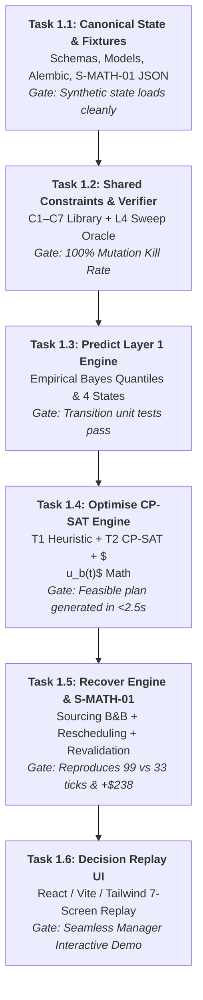

# 18 — Phased Implementation Roadmap & Phase 1 Task Plan

**Project:** ServiceYield AI  
**Authoritative Reference:** Technical Report (Sections 9.1, 9.2, 9.4) & Product Blueprint (Section 14)  
**Status:** Engineering Execution Blueprint (Phase 0)

---

## 1. Multi-Tier Build Architecture (Tier A to Tier D)

To ensure the team delivers a bulletproof, selection-winning prototype without succumbing to scope creep or premature optimization, development is structured into four sequential tiers:

```
┌────────────────────────────────────────────────────────────────────────────────────────┐
│                              THE FOUR IMPLEMENTATION TIERS                             │
├────────────────────────────────────────────────────────────────────────────────────────┤
│ ★ TIER A: CORE WORKING DEMONSTRATOR (MANDATORY PHASE 1 MVP)                            │
│   • Synthetic Dealership Adapter & Canonical State Store (PostgreSQL / Alembic)       │
│   • Hard Constraints C1–C7 Shared Library & Eligibility Gateway                       │
│   • Predict Layer 1 Deterministic Empirical Bayes Baseline (4 States)                 │
│   • Optimise T1 Earliest-Fit Heuristic (<2ms) + T2 Google OR-Tools CP-SAT Solver      │
│   • Greenfield Recover Engine (StallBreaker 2 Sourcing & Rescheduling)                │
│   • L4 Independent Sweep-Line Occupancy Verifier (Mutation-Tested)                    │
│   • L5 Authority & Commit Gateway (Manager Approval & OCC State Revalidation)         │
│   • Fixture S-MATH-01 Bit-Exact Reproduction (99 vs 33 ticks, +$238 net gain)         │
│   • Decision Replay UI (React 18 / TypeScript / Vite / Tailwind)                      │
│   • 100% LLM-Disabled Parity Verification                                             │
├────────────────────────────────────────────────────────────────────────────────────────┤
│ TIER B: ENHANCEMENTS (POST-MVP STAGING)                                                │
│   • LightGBM Quantile Regression Models (0.05, 0.50, 0.95 quantiles)                   │
│   • Conformal Prediction Calibration & Coverage Drift Monitors (`DEGRADED` flag)       │
│   • LLM Explanatory Assistant (Natural language translation of manager rationale)     │
│   • Automated Chaos Injection & Network Partition Resilience Tests                    │
├────────────────────────────────────────────────────────────────────────────────────────┤
│ TIER C: RESEARCH & ADVANCED OPTIMIZATION (COMPETITIVE ACCELERATION)                    │
│   • Large Neighbourhood Search (LNS) destroy-and-repair heuristics                    │
│   • Conditional Value at Risk (CVaR) stress testing across correlated delay scenarios  │
│   • Full 7-Family Benchmark Suite (F1–F7) across 100 paired seeds                     │
├────────────────────────────────────────────────────────────────────────────────────────┤
│ TIER D: FUTURE PRODUCTION & TEKION PARTNER DEPLOYMENT                                  │
│   • Live Tekion Automotive Partner Cloud (APC) Webhooks & OAuth 2.0 Integration       │
│   • Multi-Tenant Rooftop Isolation & Kubernetes Helm Deployments                      │
│   • Production Soc2 Type II Compliance, Audit Trails & SOC Monitoring                  │
└────────────────────────────────────────────────────────────────────────────────────────┘
```

**Build-Order Discipline Warning:** Under no circumstances shall Tier B, C, or D tasks delay the completion of Tier A. If development time becomes constrained, advanced ML models and LLM features must be cut before sacrificing the core simulator, verifier, or S-MATH-01 reproduction.

---

## 2. Phase 1 Implementation Sequence: Ordered Task Breakdown

Phase 1 implementation proceeds through six sequential, test-gated milestones:



### Detailed Task Specifications:

#### Task 1.1 — Canonical State & Data Fixtures
- **Objective:** Establish the database schema, Pydantic domain models, and load the canonical `S-MATH-01` synthetic dataset.
- **Expected Source Files:**
  - `backend/app/models/canonical.py` (SQLAlchemy 2.0 models)
  - `backend/app/schemas/domain.py` (Pydantic v2 schemas)
  - `backend/app/fixtures/s_math_01_fixture.json` (Canonical 6-RO dealership data)
  - `backend/app/core/snapshot.py` (SHA-256 snapshot generator)
- **Exit Gate:** `pytest tests/test_canonical_state.py` passes; database seeds snapshot cleanly.

#### Task 1.2 — Shared Constraints Library & L4 Independent Verifier
- **Objective:** Implement the pure-Python constraint library C1–C7 and the independent sweep-line occupancy oracle.
- **Expected Source Files:**
  - `backend/app/constraints/rules.py` (C1–C7 formal rule definitions)
  - `backend/app/verifier/sweep_oracle.py` (L4 Independent Verifier)
  - `backend/tests/test_verifier_mutations.py` (Mutation injection suite)
- **Exit Gate:** Verifier catches 100% of injected mutation corruptions (MUT-01 to MUT-07).

#### Task 1.3 — Predict Layer 1 Readiness Engine
- **Objective:** Implement deterministic empirical Bayes quantiles, slack computation, and 4-state readiness classification.
- **Expected Source Files:**
  - `backend/app/predict/engine.py` (Layer 1 predictor)
  - `backend/app/predict/slack.py` (Slack analyzer)
- **Exit Gate:** All 6 ROs in S-MATH-01 correctly categorized (RO-104 as `AT_RISK`, RO-105 as `BLOCKED`).

#### Task 1.4 — Optimise Engine (T1 Fallback & T2 CP-SAT)
- **Objective:** Implement the T1 constructive bitset scheduler and the T2 Google OR-Tools CP-SAT discrete optimizer ($H=288$ ticks).
- **Expected Source Files:**
  - `backend/app/optimise/heuristics.py` (T1 Earliest-Fit priority dispatcher)
  - `backend/app/optimise/cpsat_solver.py` (T2 OR-Tools CP-SAT formulation)
  - `backend/app/optimise/shadow_price.py` (Discrete $\nu_b(t)$ difference re-solve)
- **Exit Gate:** Generates zero-conflict baseline schedule in < 2.5s; L4 Verifier certifies `PASS`.

#### Task 1.5 — Greenfield Recover Engine & S-MATH-01 Golden Test
- **Objective:** Reimplement the two-layer branch-and-bound sourcing search, full-shop re-scheduler, and OCC approval revalidation.
- **Expected Source Files:**
  - `backend/app/recover/search.py` (Two-layer sourcing branch-and-bound)
  - `backend/app/recover/replan.py` (Disruption rescheduling pipeline)
  - `backend/app/authority/commit.py` (OCC fresh-state revalidation & outbox)
  - `backend/tests/test_s_math_01_golden.py` (Golden fixture automated test)
- **Exit Gate:** **Bit-exact reproduction of S-MATH-01: 99 to 33 weighted ticks and +$238 net economic gain.**

#### Task 1.6 — Decision Replay UI & Demonstration Assembly
- **Objective:** Construct the high-contrast React 18 / TypeScript / Tailwind interactive demonstration interface.
- **Expected Source Files:**
  - `frontend/src/components/ControlTower.tsx`
  - `frontend/src/components/ScheduleGantt.tsx`
  - `frontend/src/components/DisruptionModal.tsx`
  - `frontend/src/components/RecoveryComparison.tsx`
  - `frontend/src/components/OutcomeDashboard.tsx`
- **Exit Gate:** Service Manager Marcus clicks through Stages 1–7 seamlessly without error.
