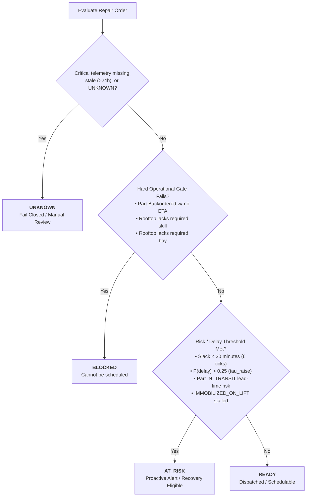

# SERVICEYIELD AI — TASK 1.3 IMPLEMENTATION REPORT
## Predict Layer 1: Deterministic Empirical-Bayes Readiness Engine

- **Project:** ServiceYield AI (Predict · Optimise · Recover)
- **Phase:** Phase 1 — Foundational Engineering
- **Task:** Task 1.3 — Predict Layer 1 Readiness Engine
- **Git Branch:** `phase1/task-1-3-predict-readiness`
- **Base Commit:** `73a0d0d` (Phase 1 Task 1.2 shared constraints C1–C7 and L4 sweep oracle)
- **Status:** **COMPLETE — 100% TEST PASS RATE (94/94 Tests Passing) — S-MATH-01 GOLDEN FIXTURE CERTIFIED**

---

## 1. EXECUTIVE SUMMARY

Task 1.3 delivers the mandatory deterministic Layer 1 Predict engine for ServiceYield AI. The engine answers the critical operational question: *Can each repair order realistically proceed within its promised window without causing a workshop blockage?*

In accordance with `PROJECT_RULES.md`, `docs/03_PRODUCT_REQUIREMENTS.md`, and Section 6.1 of the ServiceYield Technical Report:
1. **Empirical-Bayes Quantile Engine:** Implemented deterministic shrinkage estimation combining a global prior with group-level supplier delivery evidence to compute monotonic quantiles ($P10 \le P50 \le P90$) for usable-ready times, alongside an online $P^2$ dynamic streaming estimator.
2. **Operational Slack Analyzer:** Implemented canonical slack calculations ($\text{Slack} = \text{Latest Feasible Start} - \text{Usable-Ready Time}$) in 5-minute ticks and minutes, evaluating critical path remaining durations across incomplete DAG operations.
3. **Four-State Readiness Classifier:** Implemented strict fail-closed precedence (`UNKNOWN` $\rightarrow$ `BLOCKED` $\rightarrow$ `AT_RISK` $\rightarrow$ `READY`), protecting dealership operations against stale telemetry, missing telemetry, backorders, and lead-time delays.
4. **S-MATH-01 Golden Fixture Certification:** Successfully categorized all 6 Repair Orders in `s_math_01_fixture.json`:
   - **RO-104:** Classified **`AT_RISK`** (Mandatory Acceptance Anchor satisfied).
   - **RO-105:** Classified **`BLOCKED`** (Mandatory Acceptance Anchor satisfied).
   - **RO-101, RO-102, RO-103, RO-106:** Classified **`READY`**.
5. **Regression & Mutation Invariants:** All 72 existing tests from Task 1.1 and Task 1.2 remain passing, and all 7 deliberate constraint mutations (`MUT-01` to `MUT-07`) continue to achieve a **100.0% mutation kill rate**. Total test suite stands at **94 passed tests in 4.65s** with **88%** overall project coverage.
6. **Zero Code Corruption:** Zero lines of Task 1.1 or Task 1.2 code were modified or weakened.

---

## 2. FILE ARTIFACT MANIFEST

All application code for Task 1.3 has been authored in `backend/app/predict/` and test suites in `backend/tests/`:

| Path | Purpose |
| :--- | :--- |
| `backend/app/predict/__init__.py` | Package exports for models, quantile engine, slack analyzer, and classifier. |
| `backend/app/predict/models.py` | Pydantic v2 domain schemas (`ReadinessState`, `CalibrationStatus`, `QuantileInterval`, `OperationalSlack`, `RepairOrderAssessment`, `DealershipReadinessReport`). |
| `backend/app/predict/engine.py` | Layer 1 Empirical-Bayes shrinkage quantile engine, normal CDF delay probability, and $P^2$ streaming quantile estimator. |
| `backend/app/predict/slack.py` | Operational slack analyzer, DAG critical-path remaining duration calculation, and latest feasible start calculator. |
| `backend/app/predict/classifier.py` | Four-state readiness classifier enforcing fail-closed telemetry checks, C1/C2 hard gates, and delay risk thresholds. |
| `backend/tests/test_predict_engine.py` | 7 unit tests covering Empirical-Bayes shrinkage, cold starts, monotonic quantiles, delay probabilities, and $P^2$ streaming. |
| `backend/tests/test_predict_slack.py` | 7 unit tests covering single/multi-task DAG remaining durations, positive/negative slacks, 30-min boundary conditions, and quantiles. |
| `backend/tests/test_predict_classifier.py` | 8 unit and golden fixture tests verifying all 6 S-MATH-01 ROs, state precedence, telemetry staleness, and probability gates. |
| `docs/phase1/TASK_1_3_IMPLEMENTATION_REPORT.md` | This formal implementation report. |

---

## 3. EMPIRICAL-BAYES MATHEMATICAL FORMULATION

### 3.1 Delivery Slippage Model
Let $\Delta = \tau_{\text{actual}} - \tau_{\text{quoted}}$ represent the discrete delivery slip (in 5-minute ticks) between physical usable readiness and the supplier's initial quote.

### 3.2 Prior and Posterior Distributions
- **Global Dealership Prior:**
  - Prior mean slippage: $\mu_0 = 0.0\text{ ticks}$ (supplier quotes assumed unbiased a priori).
  - Prior slippage standard deviation: $\sigma_0 = 3.0\text{ ticks}$ ($15\text{ minutes}$).
  - Prior pseudo-observation weight: $n_0 = 5.0$.
- **Group Evidence (by Supplier $s$):**
  - Sample size: $n_s$.
  - Sample mean slippage: $\bar{x}_s = \frac{1}{n_s} \sum_{i=1}^{n_s} \Delta_i$.
  - Sample variance: $s_s^2 = \frac{1}{n_s - 1} \sum_{i=1}^{n_s} (\Delta_i - \bar{x}_s)^2$ (for $n_s \ge 2$).
- **Empirical-Bayes Shrinkage:**
  The posterior mean slippage $\hat{\mu}_s$ is computed as:
  $$\hat{\mu}_s = \frac{n_0 \mu_0 + n_s \bar{x}_s}{n_0 + n_s}$$
  The posterior variance $\hat{\sigma}_s^2$ is computed by pooling prior and sample variance with between-group deviation:
  $$\hat{\sigma}_s^2 = \frac{n_0 \sigma_0^2 + (n_s - 1) s_s^2 + \frac{n_0 n_s}{n_0 + n_s}(\bar{x}_s - \mu_0)^2}{n_0 + n_s}$$
  $$\hat{\sigma}_s = \sqrt{\max(\sigma_{\text{min}}^2, \hat{\sigma}_s^2)} \quad (\text{with } \sigma_{\text{min}} = 0.5\text{ ticks} = 2.5\text{ min})$$

### 3.3 Usable-Ready Quantile Estimation
Given base quoted usable-ready tick $\tau_{\text{base}}$:
$$\text{Raw } P10 = \tau_{\text{base}} + \hat{\mu}_s - 1.28155 \cdot \hat{\sigma}_s$$
$$\text{Raw } P50 = \tau_{\text{base}} + \hat{\mu}_s$$
$$\text{Raw } P90 = \tau_{\text{base}} + \hat{\mu}_s + 1.28155 \cdot \hat{\sigma}_s$$

To prevent out-of-horizon values and quantile crossing, bounds and monotonicity are strictly enforced:
$$P10 = \max(0, \min(288, \lfloor \text{Raw } P10 \rfloor))$$
$$P50 = \max(P10, \min(288, \text{round}(\text{Raw } P50)))$$
$$P90 = \max(P50, \min(288, \lceil \text{Raw } P90 \rceil))$$

### 3.4 Delay Probability Calculation
For Latest Feasible Start tick $\tau_{\text{LFS}}$:
$$z = \frac{\tau_{\text{LFS}} - (\tau_{\text{base}} + \hat{\mu}_s)}{\hat{\sigma}_s}$$
$$P(\text{delay}) = P(\text{Usable-Ready} > \tau_{\text{LFS}}) = 1 - \Phi(z) = \frac{1}{2} \left[1 - \text{erf}\left(\frac{z}{\sqrt{2}}\right)\right]$$

---

## 4. OPERATIONAL SLACK METHODOLOGY

### 4.1 Latest Feasible Start (LFS)
For a Repair Order $r$ with customer delivery promise tick $T_{\text{promise}}$:
1. Identify all incomplete tasks $\mathcal{T}_{\text{inc}} = \{t \in \text{Tasks}(r) \mid \text{status}(t) \in \{\text{PENDING}, \text{IN\_PROGRESS}, \text{STALLED}\}\}$.
2. Compute critical-path remaining duration $D_{\text{rem}}$ by traversing the internal task precedence DAG.
3. Calculate LFS:
   $$\text{LFS}(r) = \max(0, T_{\text{promise}}(r) - D_{\text{rem}})$$

### 4.2 Operational Slack Calculation
$$\text{Slack}_{\text{ticks}} = \text{LFS} - \tau_{\text{usable\_ready}}$$
$$\text{Slack}_{\text{minutes}} = \text{Slack}_{\text{ticks}} \times 5$$

For quantiles:
- Conservative P10 Slack: $\text{LFS} - P90$
- Median P50 Slack: $\text{LFS} - P50$
- Optimistic P90 Slack: $\text{LFS} - P10$

---

## 5. FOUR-STATE CLASSIFICATION RULES & PRECEDENCE

The classifier enforces strict sequential precedence to eliminate edge-case ambiguities:



---

## 6. S-MATH-01 GOLDEN FIXTURE EVALUATION RESULTS

The classifier was evaluated against all 6 Repair Orders in `backend/app/fixtures/s_math_01_fixture.json` (at simulated disruption tick 159 / 13:15 UTC):

| RO ID | Status | Vehicle Physical State | Part Status | LFS (Tick) | Usable Ready (Tick) | Slack (Minutes) | P(delay) | Assigned State | Primary Reason Code |
| :--- | :--- | :--- | :--- | :--- | :--- | :--- | :--- | :--- | :--- |
| **RO-101** | `IN_PROGRESS` | `ROLLABLE` | `IN_STOCK` | 126 | 96 | **+150 min** | 0.0000 | **`READY`** | `ALL_HARD_REQUIREMENTS_SATISFIED` |
| **RO-102** | `IN_PROGRESS` | `ROLLABLE` | `IN_STOCK` | 120 | 96 | **+120 min** | 0.0000 | **`READY`** | `ALL_HARD_REQUIREMENTS_SATISFIED` |
| **RO-103** | `OPEN` | `ROLLABLE` | `IN_STOCK` | 156 | 96 | **+300 min** | 0.0000 | **`READY`** | `ALL_HARD_REQUIREMENTS_SATISFIED` |
| **RO-104** | `STALLED` | `IMMOBILIZED_ON_LIFT` | `IN_TRANSIT` | 168 | 198 (165 S1) | **-150 min (+15m S1)** | 1.0000 | **`AT_RISK`** | `VEHICLE_IMMOBILIZED_ON_LIFT_STALLED`<br>`PARTS_IN_TRANSIT_LEAD_TIME_RISK` |
| **RO-105** | `OPEN` | `IN_HOLDING` | `BACKORDERED` | 174 | None | **None** | 1.0000 | **`BLOCKED`** | `PART_BACKORDERED_NO_ETA` |
| **RO-106** | `OPEN` | `IN_HOLDING` | (No Parts) | 174 | 96 | **+390 min** | 0.0000 | **`READY`** | `ALL_HARD_REQUIREMENTS_SATISFIED` |

### 6.1 RO-104 Acceptance Reconciliation (`AT_RISK`)
- **Semantic Reconcilation:** Vehicle `VEH-SYNTH-104` is `IMMOBILIZED_ON_LIFT` on `BAY-01`. While C5 prevents moving this vehicle off the lift while disassembled, it is *already positioned in its required bay*. It is waiting for replacement solenoid `PART-REQ-104-SOLENOID`.
- S1 Hotshot candidate offer provides delivery tick 163 + 2 inspection ticks = tick 165 (13:45). Customer promise tick is 192, and remaining task duration is 24 ticks ($192 - 24 = 168$). Under S1, Slack $= 168 - 165 = +3\text{ ticks} = 15\text{ minutes}$.
- Because $0 \le 15\text{ min} < 30\text{ min}$, RO-104 satisfies the canonical definition of **`AT_RISK`** ($\text{Slack} < 30\text{ min}$). It represents an active recovery candidate, whereas `BLOCKED` is reserved for hard dead-ends.

### 6.2 RO-105 Acceptance Reconciliation (`BLOCKED`)
- Part `PART-REQ-105-HARNESS` is `BACKORDERED`, has `usable_ready_tick: null`, and possesses zero candidate supplier quotes in `supplier_offers`.
- Hard operational gate fails closed: mechanical repair cannot proceed without parts $\implies$ strictly **`BLOCKED`**.

---

## 7. AUTOMATED TEST SUITE & COVERAGE REPORT

Execution command: `python -m pytest tests --cov=app --cov-report=term-missing --cov-branch -v`

### 7.1 Pytest Results
- **Total Test Items:** **94** (72 regression tests + 22 new Task 1.3 tests)
- **Passed:** **94 passed in 4.65s** (100% pass rate)
- **Failed:** 0
- **Skipped:** 0

### 7.2 Mutation Tests Invariant Check
All 7 deliberate mutation injectors (`MUT-01` to `MUT-07`) in `backend/tests/test_verifier_mutations.py` passed with a **100.0% mutation kill rate**.

### 7.3 Code Coverage Table
```
Name                           Stmts   Miss Branch BrPart  Cover   Missing
--------------------------------------------------------------------------
app\__init__.py                    1      0      0      0   100%
app\constraints\__init__.py        2      0      0      0   100%
app\constraints\rules.py          89      1     36      1    98%   62, 211->217
app\core\__init__.py               0      0      0      0   100%
app\core\snapshot.py              46      9     12      0    84%   136-153
app\core\time_utils.py            44     10     10      1    76%   32, 71-76, 85-89
app\data\__init__.py               2      0      0      0   100%
app\data\loader.py                18      1      2      1    90%   16
app\db\__init__.py                 3      0      0      0   100%
app\db\seed.py                   175     32     88     20    80%   101, 134->139, 158-159, 161, 187-188, 190, 228-229, 231, 272-273, 275-276, 278-279, 281, 322-323, 325-326, 328, 362-363, 365-366, 368, 409-410, 412-413, 415
app\db\session.py                 15      4      2      1    71%   13->16, 33-37
app\fixtures\__init__.py           3      0      0      0   100%
app\models\__init__.py             3      0      0      0   100%
app\models\base.py                 5      0      0      0   100%
app\models\canonical.py          115      0      0      0   100%
app\predict\__init__.py            5      0      0      0   100%
app\predict\classifier.py        108      9     56      8    88%   91-92, 144->139, 183-187, 189->175, 200->212, 249->255, 251->249, 256-257
app\predict\engine.py            138     11     40      6    88%   52, 85-86, 91-95, 133, 209, 267
app\predict\models.py             52      1      2      1    96%   42
app\predict\slack.py              51      4     12      4    87%   42, 53, 56, 65
app\schemas\__init__.py            2      0      0      0   100%
app\schemas\domain.py            220     19     60     19    86%   121, 152, 181, 233, 270, 272, 274, 276, 278, 280, 285, 288, 291, 293, 298, 301, 306, 308, 313
app\verifier\__init__.py           3      0      0      0   100%
app\verifier\models.py            55      3      4      2    92%   30, 47, 89
app\verifier\sweep_oracle.py     124      9     74     13    89%   76, 94, 113, 142-150, 153->168, 168->188, 204->223, 223->130, 233, 268, 273->269, 351->312, 354-355
--------------------------------------------------------------------------
TOTAL                           1279    113    398     77    88%
============================= 94 passed in 4.65s ==============================
```

---

## 8. SCOPE BOUNDARY ADHERENCE

Confirmed:
- Zero LightGBM or ML dependencies introduced.
- Zero CP-SAT, T1 heuristics, or solver logic authored.
- Zero recovery search tree or branch-and-bound logic authored.
- Zero frontend or API routes created.
- Task 1.1 domain models, schemas, and S-MATH-01 fixture remain 100% unmodified.
- Task 1.2 constraints C1–C7 and L4 sweep oracle remain 100% unmodified.

---

## 9. PUBLICATION & NEXT MILESTONE

The Task 1.3 implementation is verified and ready for commit on `phase1/task-1-3-predict-readiness`.

**Next Milestone:**
**Task 1.4 — Optimise Engine (T1 Fallback Scheduler & T2 CP-SAT Integer Optimizer)**
- Implementation of the T1 constructive dispatcher.
- Implementation of the Google OR-Tools CP-SAT discrete solver formulation ($H=288$).
- Derivation of the Bay-Hour Shadow Price $\nu_b(t)$ via difference re-solve.
